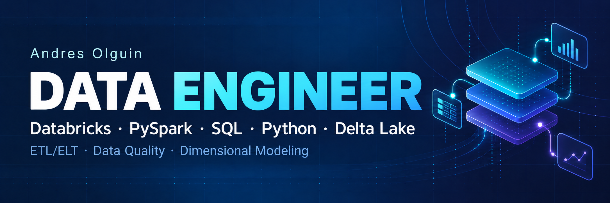
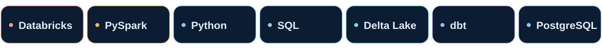
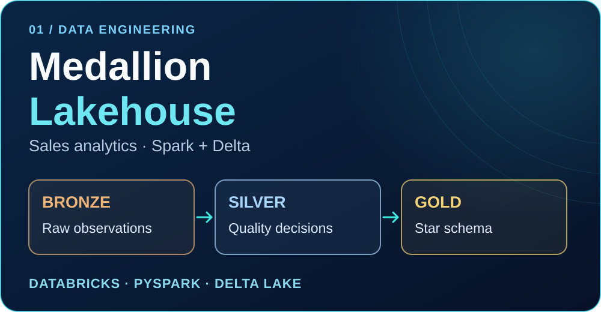
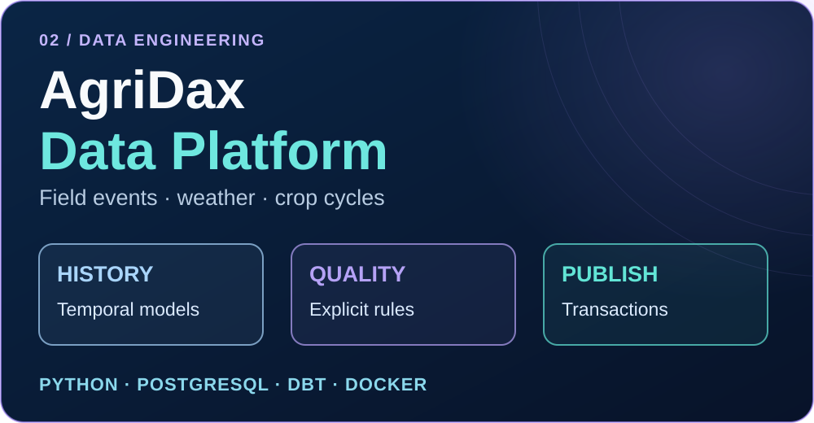

# Andrés Olguín · Data Engineer

[English](README.md) · **Español**

[LinkedIn](https://www.linkedin.com/in/andyolguin/) · [CV ES](cv/Andres_Olguin_CV_ES.pdf) · [Resume EN](cv/Andres_Olguin_CV_EN.pdf) · [CV PT](cv/Andres_Olguin_CV_PT.pdf) · [Email](mailto:andyolguint720@gmail.com)

Desarrollo y valido **pipelines ETL/ELT** con **Databricks, PySpark, Python y SQL**, con foco en calidad de datos, modelado dimensional y reprocesos confiables.

Mi experiencia profesional combina workflows de datos en la nube, operaciones de datos y coordinación técnica. Trabajé con Azure Data Factory, ADLS Gen2, Azure Databricks, Azure DevOps y PostgreSQL sobre AWS RDS, junto con validaciones en Python/SQL y documentación operativa.

**Disponible para oportunidades remotas como Data Engineer · Inglés, español y portugués**

## Stack principal

**Ingeniería de datos:** ETL/ELT · Arquitectura Medallion · Calidad de datos · Modelos estrella · Idempotencia · CI/CD

## Proyectos de ingeniería destacados

Estos repositorios documentan mis implementaciones, decisiones de diseño y ejemplos reproducibles.

<table>
<tr>
<td width="50%" valign="top">

<h3><a href="https://github.com/andresolguin/databricks-medallion-lakehouse-pipeline">Databricks Medallion Lakehouse</a></h3>

Transforma entregas CSV de ventas en un modelo estrella validado, con tratamiento de duplicados, correcciones, backfills y trazabilidad de origen.

<strong>Stack:</strong> PySpark · Spark SQL · Delta Lake · Unity Catalog

<strong>Qué demuestra:</strong> capas Medallion, decisiones explícitas de calidad, reprocesos seguros y reconciliación de hechos.

<a href="https://github.com/andresolguin/databricks-medallion-lakehouse-pipeline/blob/main/docs/architecture.md">Arquitectura</a> · <a href="https://github.com/andresolguin/databricks-medallion-lakehouse-pipeline/blob/main/docs/runbook.md">Runbook</a> · <a href="https://github.com/andresolguin/databricks-medallion-lakehouse-pipeline/blob/main/docs/validation.md">Validación</a>

Verificado con Spark/Delta local y CI. La validación en un workspace de Databricks está pendiente.

</td>
<td width="50%" valign="top">

<h3><a href="https://github.com/andresolguin/agridax-data-platform">AgriDax Data Platform</a></h3>

Organiza operaciones agrícolas, eventos de campo y clima en marts analíticos, con modelado temporal, controles de calidad y publicación controlada.

<strong>Stack:</strong> Python · PostgreSQL 16 · dbt Core · Docker Compose

<strong>Qué demuestra:</strong> tratamiento de revisiones, historia de negocio, cuarentena, recuperación y publicación transaccional.

<a href="https://github.com/andresolguin/agridax-data-platform/blob/main/README.md">Descripción e instalación</a> · <a href="https://github.com/andresolguin/agridax-data-platform/tree/main/docs/adr">Decisiones de diseño</a> · <a href="https://github.com/andresolguin/agridax-data-platform/blob/main/docs/recovery.md">Recuperación</a>

Implementación local con Python/PostgreSQL/dbt. GCP/BigQuery es la arquitectura objetivo.

</td>
</tr>
</table>

## Cómo trabajo

- **Explicito el contrato de datos:** grano, claves, tipos y reglas de rechazo.
- **Contemplo los cambios:** duplicados, revisiones, datos tardíos y reprocesos.
- **Verifico los resultados:** reconcilio claves y valores, conservo trazabilidad y hago visibles las fallas.
- **Facilito la reproducción:** incluyo instalación, pruebas y decisiones de arquitectura.

## Experiencia y colaboración

Además de ingeniería de datos, mi trayectoria incluye coordinación de equipos técnicos, entrenamiento y evaluación de LLM, investigación universitaria con Python y enseñanza de fundamentos de programación en UTN-FRGP.

Para oportunidades, conversaciones técnicas o colaboración: **[LinkedIn](https://www.linkedin.com/in/andyolguin/)** · **[Email](mailto:andyolguint720@gmail.com)**
